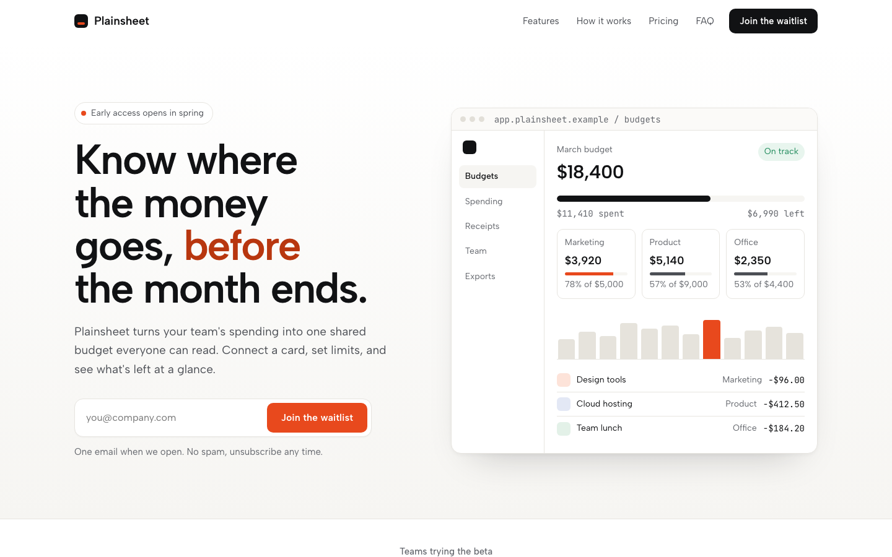

# Signal: one-page landing page for startups and products (HTML)

A free one-page landing page template for startups and SaaS products. Plain HTML, CSS and JavaScript.

**[Live demo](https://suhailnkhan.com/preview/signal-free-startup-landing-page-template-html)** · [Template page](https://suhailnkhan.com/products/signal-free-startup-landing-page-template-html) · [More templates](https://suhailnkhan.com/products?category=template)

## Use it

1. Click **Code → Download ZIP** (or clone the repo).
2. Open `index.html` in your browser. There's nothing to install or build.
3. Follow [GUIDE.md](GUIDE.md) to put in your own content, then upload the folder to any host: GitHub Pages, Netlify, Vercel or shared hosting.

## Licence

MIT: free for personal and client projects. A small "Template by Suhail N Khan" link sits in the footer. Keeping it is appreciated, not required.

## Want it set up for you?

I can put in your content, connect your domain and adapt the design. [Get a quote](https://suhailnkhan.com/services?utm_source=github&utm_medium=readme&utm_campaign=signal).
